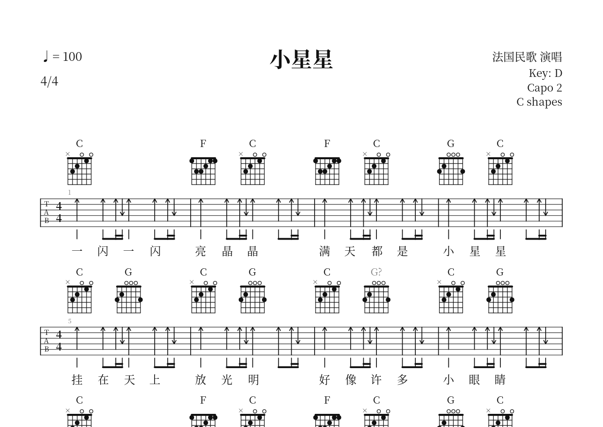
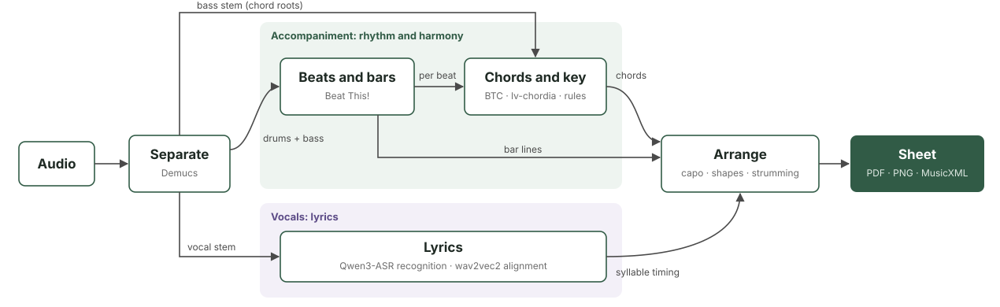

<div align="center">

# OpenBapo

**Turn any song into a guitar play-along sheet, right inside Discord.**

Chord diagrams, a strumming tab and the lyrics on one page,
ready to play and sing. Chinese and English songs.

[](https://github.com/Ariza-Sun/OpenBapo/actions/workflows/ci.yml)
[](LICENSE)

[](https://discord.gg/9ZVeBEU3p)

[**Join on Discord**](https://discord.gg/9ZVeBEU3p) · [**Add to your server**](#use-it-on-discord) · [**Host your own**](#host-your-own) · [**How it works**](#how-it-works)



</div>

*Bapo* (扒谱, *bā pǔ*) is what Chinese guitarists call working out a song's chords by ear. OpenBapo does it for you: send it a recording and a few minutes later you get the kind of play-along sheet that guitar books and tab sites print, made for beginners who just want to strum and sing.

It is a hobby project, made for fun and practice. The sheets are a first draft by a computer: good enough to play along with, but expect the odd wrong chord or misheard lyric.

## Features

- 🎸 **A complete sheet from a recording.** Chords, key, tempo, time signature, a strum pattern and time-aligned lyrics.
- 🎤 **Sing in your own key.** Move the song up or down by up to 6 semitones; the chords follow.
- 🖐️ **Play with shapes you know.** Pick the chord shapes (C, G, D, A, E …) and OpenBapo works out the capo, or tells you to tune down.
- 🥁 **Pick a strum pattern by its picture.** Strumming and fingerpicking patterns, drawn the way they appear on the sheet.
- 🎼 **Simple chords on request.** Turn 7ths, sus and slash chords into plain triads with one switch.
- 📄 **Take it with you.** PDF, PNG or MusicXML (opens in MuseScore and Guitar Pro for further editing).
- 🔒 **Private by design.** Audio is deleted as soon as it has been analyzed; sheets are deleted after 30 days.

## Use it on Discord

The quickest way to try it: **[join the OpenBapo server](https://discord.gg/9ZVeBEU3p)** and use it in `#transcribe`. You can ask questions and share sheets there too.

To use it in your own server or anywhere on Discord:

1. **[Add OpenBapo to your server](https://discord.com/oauth2/authorize?client_id=1575036006346920016&scope=bot+applications.commands&permissions=309237763072)**, or **[add it to your account](https://discord.com/oauth2/authorize?client_id=1575036006346920016&integration_type=1&scope=applications.commands)** to use it anywhere, including in direct messages.
2. Type **`/transcribe`** and attach a song (mp3, m4a, ogg, opus, wav or flac; up to 10 minutes).
3. Wait a few minutes. The sheet appears with menus to change the key, the chord shapes and the strum pattern, and buttons to simplify or export.

In a server channel, each song gets its own thread so the channel stays tidy. To keep a song to yourself, send `/transcribe` to OpenBapo in a direct message instead.

| Command | What it does |
|---|---|
| `/transcribe` | Make a sheet from an audio file. Also in the message menu: right-click a message with audio → **Apps** → **Transcribe** |
| `/status` | See your recent sheets and open any of them again |
| `/delete` | Delete everything OpenBapo keeps about you (asks first) |
| `/help` | The short version of this section |

> [!NOTE]
> The public bot allows 5 songs per person per day and is a best-effort service run by one person on one GPU. If it is busy, or you want it for a bigger community, [host your own](#host-your-own).

## Host your own

You need a Linux machine with an **NVIDIA GPU** (12 GB of memory or more is comfortable; we run an RTX 3090) and about **15 GB of disk** for the model weights. A CPU works too, only much slower.

```bash
git clone https://github.com/Ariza-Sun/OpenBapo.git
cd OpenBapo
python -m venv .venv && source .venv/bin/activate

# 1. PyTorch for your CUDA version (see pytorch.org), then OpenBapo itself
pip install torch==2.14.1 torchaudio==2.11.0 --index-url https://download.pytorch.org/whl/cu126
python deploy/install.py

# 2. Download the model weights once (about 9 GB)
openbapo download-models

# 3. Start the bot with your Discord bot token
export DISCORD_TOKEN=...            # from the Discord Developer Portal
export OPENBAPO_DATA_DIR=$PWD/data
openbapo-bot
```

You also need `ffmpeg`, `libcairo2` and a CJK font such as Noto CJK on the system (`apt install ffmpeg libcairo2 fonts-noto-cjk` on Debian and Ubuntu).

**[The self-hosting guide](docs/self-hosting.md)** walks through creating the Discord application, the permissions it needs, running with Docker, every setting, and what is stored where.

### Without Discord

The same pipeline runs from the command line:

```bash
openbapo analyze song.mp3 --out song.analysis.json      # the models: a minute or two on a GPU
openbapo arrange song.analysis.json --out song.sheet.json --transpose -2 --fingering-key G
openbapo render song.sheet.json --pdf song.pdf --png song.png --musicxml song.musicxml
```

`arrange` and `render` need no models and no GPU. Try them on the included example with `pip install -e ".[render]"`:

```bash
openbapo arrange examples/twinkle.analysis.json --out twinkle.sheet.json
openbapo render twinkle.sheet.json --png twinkle.png
```

Run `openbapo <command> --help` for every option.

## How it works



1. **Separate.** Split the mix into vocals, drums, bass and the rest. The stems stay in memory and are never stored or shared.
2. **Beats and bars.** Find every beat and downbeat, then settle the tempo and time signature.
3. **Chords and key.** Several chord recognizers vote on every beat; the bass line and the key break ties.
4. **Lyrics.** Recognize the sung words and align every syllable to the beat it is sung on.
5. **Arrange.** Choose the chord shapes and capo, pick a strum pattern for the tempo and meter, optionally simplify chords.
6. **Render.** Draw each line of the sheet as three rows: chord diagrams on top, the strumming tab in the middle and the lyrics underneath, like a printed play-along sheet.

The analysis (steps 1–4) runs once per song. Arranging and rendering take about a second, so changing the key or the strum pattern is instant and never reruns the models.

## Models

OpenBapo's code is MIT-licensed. The model weights are downloaded from their authors on first use and are not part of this repository; each is licensed by its authors.

| Step | Model |
|---|---|
| Source separation | [Demucs v4](https://github.com/adefossez/demucs) `htdemucs` |
| Beats | [Beat This!](https://github.com/CPJKU/beat_this) |
| Chords | [BTC](https://github.com/jayg996/BTC-ISMIR19) and [lv-chordia](https://github.com/openmirlab/lv-chordia), plus rule-based experts |
| Voice activity | [Silero VAD](https://github.com/snakers4/silero-vad) |
| Lyrics recognition | [Qwen3-ASR 1.7B](https://huggingface.co/Qwen/Qwen3-ASR-1.7B) with [Qwen3-ForcedAligner 0.6B](https://huggingface.co/Qwen/Qwen3-ForcedAligner-0.6B) (default), or [Whisper large-v3](https://huggingface.co/Systran/faster-whisper-large-v3) via faster-whisper |
| Lyrics alignment | wav2vec2: [LV-60K](https://pytorch.org/audio/stable/generated/torchaudio.pipelines.WAV2VEC2_ASR_LARGE_LV60K_960H.html) for English, [XLSR-53 zh-CN](https://huggingface.co/jonatasgrosman/wav2vec2-large-xlsr-53-chinese-zh-cn) for Chinese |

## Good to know

- **Accuracy.** Chords are usually right on clear pop and folk recordings and less so on dense mixes, live recordings or jazzy harmony. Low-confidence chords are marked with a `?`. Lyrics can be misheard; a song with no lyrics found still gets its chord sheet.
- **Upload size.** OpenBapo accepts files up to 20 MB, but Discord itself limits free accounts to 10 MB. A 10-minute MP3 at 128 kbps is about 10 MB.
- **Copyright.** Only upload audio you own or are licensed to use. The songs and lyrics belong to their rights holders; the sheets are for personal practice.
- **Languages.** The bot's replies follow each user's Discord language: Chinese for Chinese clients, English for everyone else. Lyrics are recognized in Chinese and English.

## Development

```bash
pip install -e ".[dev,render]"
ruff format --check . && ruff check . && mypy && pytest
```

The tests use fakes in place of the models, so they run in seconds on a laptop. `pytest -m models` runs the real models and needs the `analysis` extra.

Bug reports and pull requests are welcome. For a wrong chord or lyric, the song's name, the time in the song and what you expected are the most useful things to include. Please don't attach copyrighted audio to issues.

## License

[MIT](LICENSE) for the code. The model weights are licensed by their authors; see [Models](#models).

## Acknowledgements

OpenBapo stands on the work of the authors of Demucs, Beat This!, BTC, lv-chordia, Silero VAD, Qwen3-ASR, Whisper and faster-whisper, wav2vec2 and torchaudio, and [discord.py](https://github.com/Rapptz/discord.py). Thank you.
